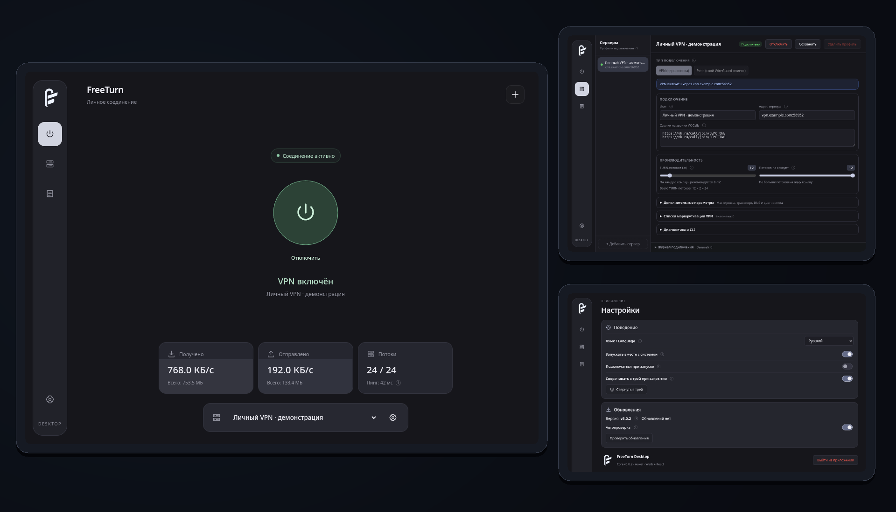
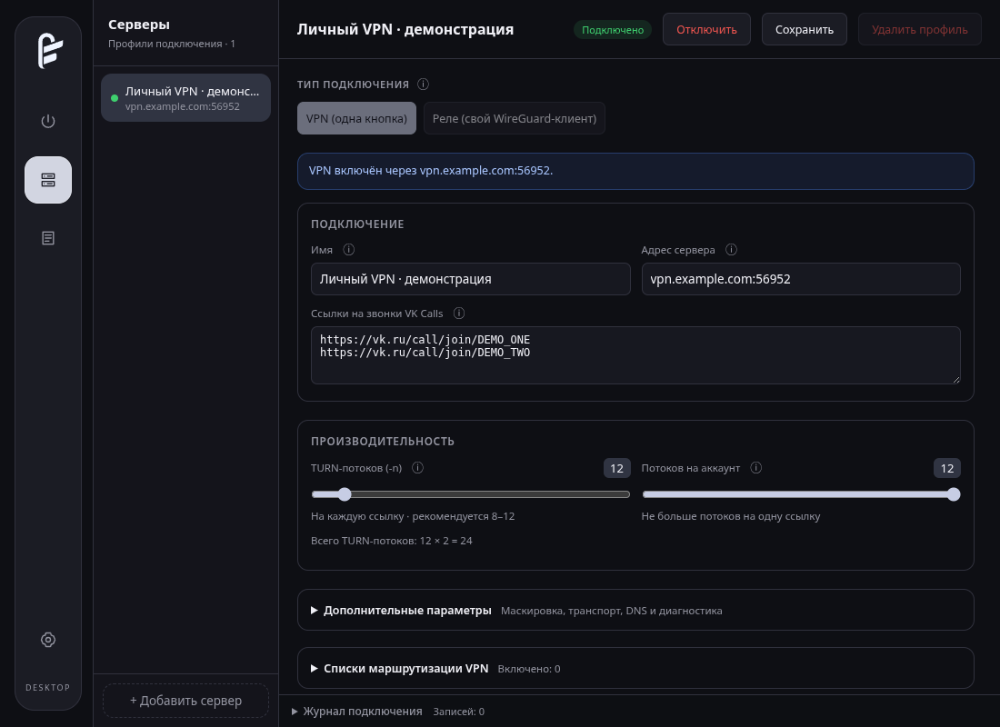

<div align="center">


# FreeTurn Desktop

**Ваш VPN. Ваш сервер. Один клиент для Windows, Linux и macOS.**

WireGuard и AmneziaWG через TURN — с понятным интерфейсом,
управлением серверами и автоматическими обновлениями.

[](https://github.com/yaroslav4167/free-turn-desktop/releases/latest)
[](https://github.com/yaroslav4167/free-turn-desktop/actions/workflows/build.yml)

**[Скачать](https://github.com/yaroslav4167/free-turn-desktop/releases/latest)** ·
[Возможности](#возможности) · [Установка](#установка) · [Сборка](#сборка-из-исходников)



<sub>Общий интерфейс с демонстрационными данными. Снимки получены в браузерном макете; детали могут отличаться на разных платформах.</sub>

</div>

## Возможности

| | Что доступно |
| :--- | :--- |
| **Подключение одной кнопкой** | Встроенный VPN на базе WireGuard/AmneziaWG, состояние соединения, графики трафика и пинг. |
| **Свой сервер** | Импорт `freeturn://`-ссылок, настройка VPS по SSH и управление пользователями. |
| **Совместимость с Android** | Подключение к поддерживаемым контейнерам hackdiaz без повторной установки сервера. Для каждого устройства — отдельный профиль. |
| **Гибкая маршрутизация** | Списки доменов, IP-адресов и подсетей с отдельными правилами для каждого профиля. |
| **Удобная работа** | Системный трей или строка меню, запуск вместе с системой, автоподключение и отдельные уведомления о проверке VK. |
| **Проверяемые обновления** | Выбор архива под свою ОС и архитектуру, проверка SHA-256, подтверждение установки и откат при неудачном запуске. |
| **Русский и английский** | Переключение языка в настройках и расширяемые JSON-каталоги переводов. |

Нативная VPN-интеграция сохранена для каждой системы: **VPN-helper на Linux**,
**Wintun на Windows**, **utun и launchd-helper на macOS**.

Оформление использует три отдельных ресурса: цветной знак приложения без фона,
плоский знак внутри интерфейса и плотный одноцветный значок трея.

Потоки настраиваются связанными ползунками. `TURN-потоков (-n)` — число потоков
**на одну ссылку**; при трёх ссылках и значении 12 получится 36 потоков суммарно.
«Потоков на аккаунт» не может превышать число потоков на ссылку. Последняя группа
может быть неполной; больше потоков не означает гарантированно больше скорости.

В настройках на виду остаются основные поля и производительность. Редкие параметры,
маршрутизация и управление VPS раскрываются отдельно; пояснения доступны по `(i)`.
При включении VPN статус и индикатор появляются сразу, ещё во время подготовки
маршрутов и системного helper; подключение можно отменить.

Начиная с v3.0.4 доступны **светлая, тёмная и системная темы**.
По умолчанию — «Как в системе». Выбор в настройках сохраняется и применяется без
перезапуска VPN; системный режим реагирует на смену темы ОС.
[Пример светлой темы](docs/screenshots/settings-light.png) — браузерный макет с демонстрационными данными.

## Скачать

Все актуальные сборки находятся на странице **[последнего релиза](https://github.com/yaroslav4167/free-turn-desktop/releases/latest)**.

| Система | Какой архив выбрать |
| :--- | :--- |
| **Windows · x64** | `FreeTurn-Windows-amd64-v….zip` |
| **Linux · x64** | `FreeTurn-Linux-amd64-v….tar.gz` |
| **macOS · Apple Silicon** | `FreeTurn-macOS-arm64-v….zip` |
| **macOS · Intel** | `FreeTurn-macOS-amd64-v….zip` |

Рядом с архивами опубликован файл `checksums.txt` с контрольными суммами SHA-256.
Встроенное обновление само выбирает нужную платформу и проверяет скачанный файл.

## Установка

### Windows

1. Распакуйте ZIP в отдельную папку.
2. Запустите **`Install.cmd`** и следуйте подсказкам установщика.
3. Импортируйте профиль или добавьте свой сервер.

В архиве также есть **`Uninstall.cmd`** для удаления клиента.

### Linux

Распакуйте архив и запустите установщик **от обычного пользователя**:

```sh
./install-desktop.sh
```

Установщик настроит VPN-helper и предложит создать ярлык. Для удаления используйте
`./uninstall-desktop.sh`.

### macOS

Требуется **macOS 13 или новее**. Распакуйте ZIP и перенесите **`FreeTurn.app`**
в `/Applications` или `~/Applications`. При первом VPN-подключении приложение
запросит разрешение администратора на установку системного helper.

> **Важно:** сборки подписаны ad-hoc, без нотариального заверения Apple.
> Если macOS блокирует запуск, разрешите открытие приложения в разделе
> «Системные настройки → Конфиденциальность и безопасность».
> Отключать Gatekeeper целиком не нужно.

Подробнее о правах, обновлении и удалении helper — в [инструкции для macOS](docs/macos.md).

## Первое подключение

1. **Добавьте профиль:** импортируйте готовую `freeturn://`-ссылку или подключитесь к VPS по SSH.
2. **Выберите сервер:** мастер обнаружит поддерживаемую существующую установку; на пустом VPS сможет создать новую.
3. **Включите VPN.** Если VK запросит проверку, откройте её из уведомления приложения.

В текущей ветке `main` проверка сначала автоматически открывается в отдельном
окне **FreeTurn** на системном WebView, без запроса выбора браузера (ещё не в
v3.0.5). Если окно недоступно, используется внешний браузер; переключиться в него
вручную можно кнопкой «Открыть в браузере». Закрытие окна проверки не отключает
работающие потоки. Подробнее: [изоляция окна captcha](docs/captcha-window.md).

Перед решением captcha клиент один раз повторяет обычный запрос авторизации:
если VK уже не требует проверку, браузер не нужен. Если виджет в браузере не
загрузился, появится пояснение с кнопкой обновления; подробности доступны в
журнале приложения. Само требование проверки задаёт VK, отключить его навсегда
этим повтором нельзя.

При подключении к существующему контейнеру сервер не переустанавливается и не
перезапускается. Если адрес в выданном профиле отличается от SSH-хоста, мастер
попросит выбрать адрес реле. Совпадающие адреса сохраняются без лишнего выбора.

**Для VPS с меняющимся IP используйте доменное имя и поддерживайте его DNS-запись
актуальной.** Уже сохранённые профили с IP-адресом не изменяются автоматически.

> Ссылки с клиентским профилем могут содержать приватный ключ WireGuard и Client ID.
> Не публикуйте их в задачах GitHub, журналах или скриншотах.

## Переход из старых репозиториев

Разработка клиентов Windows, Linux и macOS объединена в **этом репозитории**.
Старые репозитории предлагают прямое обновление до **v3.0.0**, в которую уже
встроен новый источник обновлений. После этого следующие версии приходят отсюда.
Переходные v2.6.6 / v1.1.4 / v0.2.3 устанавливать не требуется.

Можно также сразу скачать актуальную сборку из [общего репозитория](https://github.com/yaroslav4167/free-turn-desktop/releases/latest)
и установить её вручную. **Профили и настройки сохраняют прежние каталоги хранения.**
Старые релизы и теги остаются доступны; серверы на VPS при переходе не изменяются.

<details>
<summary><strong>Посмотреть отдельные экраны интерфейса</strong></summary>

### Подключение и трафик


### Профили серверов



### Настройки приложения


</details>

## Сборка из исходников

<details>
<summary><strong>Требования, команды и проверка релизов</strong></summary>

Нужны версия **Go из `go.mod`** и **Node.js 22.18+**. Сборка выполняется на целевой ОС.

**Linux:** установите пакеты разработки GTK3 и WebKit2GTK 4.1, затем выполните:

```sh
VERSION=v3.0.5 sh packaging/linux/build-desktop.sh
```

**Windows:** установите нативные зависимости Wails и запустите в PowerShell 7:

```powershell
$env:RELEASE_TAG = 'v3.0.5'
./packaging/windows/build-desktop.ps1
```

**macOS:** установите Xcode Command Line Tools, затем выполните:

```sh
RELEASE_TAG=v3.0.5 sh packaging/macos/build-desktop.sh
```

`UPDATE_REPOSITORY` по умолчанию указывает на `yaroslav4167/free-turn-desktop`.
Результаты сборки сохраняются в `dist/`.

GitHub Actions собирает приложение на Ubuntu 22.04, Windows, Apple Silicon и Intel
macOS. Публикация выполняется только после успешных проверок **всех четырёх сборок**
и контрольных сумм архивов. Автоматические проверки не заменяют проверку живого
VPN-подключения в конкретной сети.

Коллаж для README можно пересоздать без дополнительных графических библиотек:

```sh
go run scripts/render-readme-collage.go
```

</details>

## Документация и благодарности

- [Работа с общим Docker-сервером](docs/shared-docker-server.md)
- [Локализация интерфейса](docs/localization.md)
- [Интеграция с macOS](docs/macos.md)
- [Описание последнего выпуска](RELEASE_NOTES_DESKTOP.md)
- [Происхождение логотипа и пересоздание иконок](docs/branding.md)

В основе проекта — [FreeTurn Proxy](https://github.com/hackdiaz-dev/free-turn-proxy).
Сохранены история и наработки отдельных десктопных форков, а также исходные указания
авторства. Путь Go-модуля оставлен прежним для совместимости импортов.

Лицензия кода — [LICENSE](LICENSE). Знак адаптирован из Android-клиента
[hackdiaz-dev/turn-proxy-android](https://github.com/hackdiaz-dev/turn-proxy-android);
для этих визуальных ресурсов сохранена отдельная [GNU GPL v3](docs/licenses/android-branding-GPL-3.0.txt).
