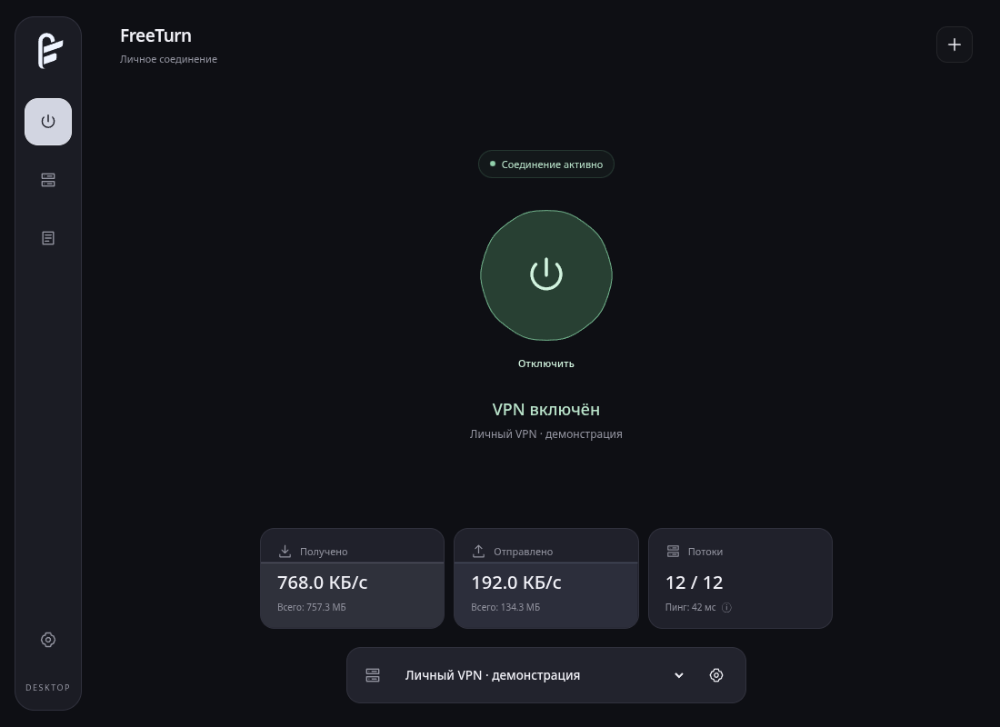
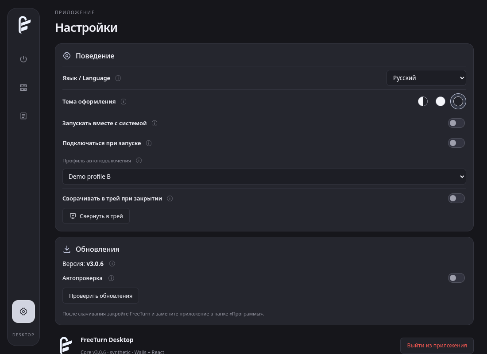

# FreeTurn Desktop

One desktop client and release stream for **Windows, Linux and macOS**.
Based on [FreeTurn Proxy](https://github.com/hackdiaz-dev/free-turn-proxy), with
the native integrations and history of the three desktop forks preserved.

## Downloads

[Releases](https://github.com/yaroslav4167/free-turn-desktop/releases/latest)
contain all four native builds and a shared `checksums.txt`:

| Platform | Archive | Installation |
| --- | --- | --- |
| Linux amd64 | `FreeTurn-Linux-amd64-v*.tar.gz` | Extract and run `./install-desktop.sh` |
| Windows amd64 | `FreeTurn-Windows-amd64-v*.zip` | Extract and run `Install.cmd` |
| macOS Apple Silicon | `FreeTurn-macOS-arm64-v*.zip` | Move `FreeTurn.app` to Applications |
| macOS Intel | `FreeTurn-macOS-amd64-v*.zip` | Move `FreeTurn.app` to Applications |

Verify the archive's SHA-256 against `checksums.txt`. macOS requires 13+;
builds are ad-hoc signed, not Apple-notarized. No global Gatekeeper changes
are needed. See [macOS helper and permissions](docs/macos.md).

## Features

- WireGuard/AmneziaWG through TURN, with native Linux helper, Windows Wintun,
  and macOS utun/launchd helper.
- Animated connection control, independent captcha prompts, traffic charts,
  ping, per-profile routing lists and server/client management over SSH.
- Russian/English JSON localization, startup/auto-connect, tray/menu-bar
  integration, verified updates with explicit confirmation and rollback.
- Reuse of supported hackdiaz Docker servers with a distinct profile for each
  device. No automatic server reinstall or restart during attachment.

See [shared Docker setup](docs/shared-docker-server.md) and
[localization](docs/localization.md). Existing unknown server installations
are never adopted or overwritten automatically.

## Migrating from the separate repositories

Install the final bridge release from your existing client's update screen:

- Linux: **v2.6.6** in `yaroslav4167/free-turn-linux`.
- Windows: **v1.1.4** in `yaroslav4167/free-turn-windows`.
- macOS: **v0.2.3** in `yaroslav4167/free-turn-macos`.

That build changes the update source to this repository. Its next update is
the shared **v3.0.0**, selecting only the archive for the current platform and
architecture. Manual installation from this repository also works. Profiles,
preferences and installed-helper identities keep their existing storage paths.
Old tags and downloads remain available; old repositories are not deleted.
Server installations on VPSs are not migrated, restarted or removed by this
desktop-repository migration.

## Building

Use the Go version in `go.mod` and Node.js 22.18+. Build on the target OS:

```sh
# Linux: GTK3 and WebKit2GTK 4.1 development packages are required.
VERSION=v3.0.0 sh packaging/linux/build-desktop.sh

# macOS: Xcode Command Line Tools are required.
RELEASE_TAG=v3.0.0 sh packaging/macos/build-desktop.sh
```

On Windows, run `packaging/windows/build-desktop.ps1` from PowerShell 7 with
Wails' native Windows build prerequisites installed. Set `RELEASE_TAG` for the
build version. `UPDATE_REPOSITORY` defaults to this repository on all platforms.

GitHub Actions builds on Ubuntu 22.04, Windows, Apple Silicon and Intel macOS,
runs native tests, and publishes only after **all four** builds pass and every
archive checksum is verified. Native CI is not a live VPN acceptance test on
every network. See [release notes](RELEASE_NOTES_DESKTOP.md).





## License

See [LICENSE](LICENSE). Original upstream and desktop-fork histories and
attribution are retained. The Go module path is intentionally unchanged to
preserve existing imports and linker targets.
